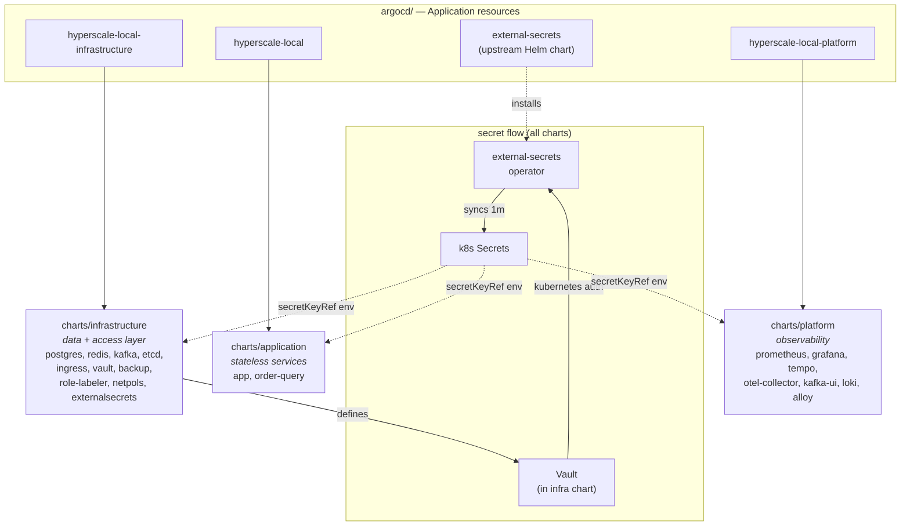
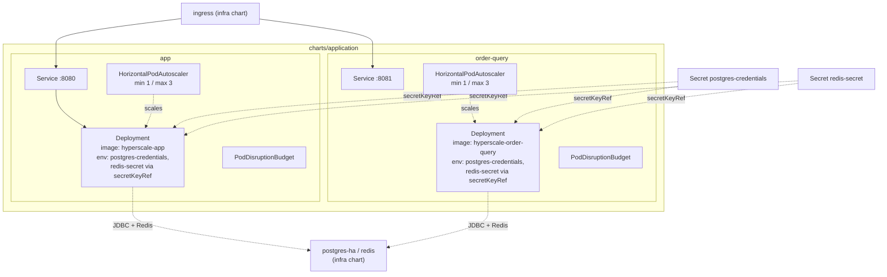
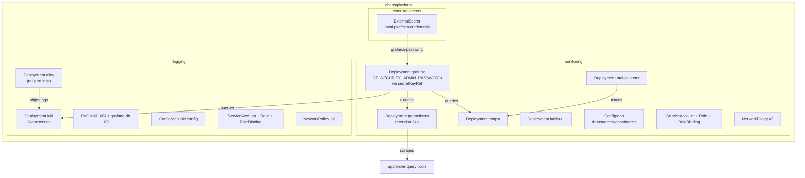

# Architecture — Resource Map & Kind Glossary

Resource inventory of the three charts (`application`, `infrastructure`,
`platform`) plus the ArgoCD layer, with a definition of every Kubernetes kind
used.

## Overview — charts and how they relate

## charts/application

Stateless Spring Boot services. HPA owns replica counts (ArgoCD
`ignoreDifferences` on `/spec/replicas`).

## charts/infrastructure

Stateful data layer + cluster access. Pattern: `StatefulSet + headless
Service + PDB + volumeClaimTemplate` per component.

```mermaid
flowchart TB
    subgraph chart["charts/infrastructure"]
        subgraph pg["postgres-ha (Patroni)"]
            PSS["StatefulSet ×3"]
            PHS["Service headless"]
            PPR["Service primary<br/>selector role=primary"]
            PPVC["PVC per pod (pgdata)"]
            PPDB["PodDisruptionBudget"]
        end
        subgraph bk["backup"]
            BCJ["CronJob<br/>pg_basebackup 02:00 UTC"]
            BPVC["PVC pgbackrest-repo"]
        end
        subgraph rd["redis"]
            RSS["StatefulSet"]
            RSVC["Service + headless"]
            RPVC["PVC per pod"]
            RPDB["PodDisruptionBudget"]
        end
        subgraph kf["kafka"]
            KSS["StatefulSet ×3"]
            KSVC["Service + headless"]
            KPDB["PodDisruptionBudget"]
        end
        subgraph et["etcd"]
            ESS["StatefulSet ×3"]
            ESVC["Service + headless"]
            EPDB["PodDisruptionBudget"]
        end
        subgraph ig["ingress (HAProxy)"]
            ISS["StatefulSet"]
            ICM["ConfigMap"]
            ISVC["Service ×2 (NodePort)"]
            IPDB["PodDisruptionBudget"]
        end
        subgraph vt["vault"]
            VSS["StatefulSet<br/>containers: vault + vault-init"]
            VCM["ConfigMap<br/>vault.hcl + init.sh"]
            VSVC["Service + headless"]
            VSA["ServiceAccount"]
            VCRB["ClusterRoleBinding<br/>system:auth-delegator"]
            VPVC["PVC vault-data<br/>(sealed data + init.json)"]
        end
        subgraph es["external-secrets"]
            ESSA["ServiceAccount vault-auth"]
            EST["Secret vault-auth-token"]
            ECS["ClusterSecretStore vault-backend"]
            EEX["ExternalSecret ×2<br/>postgres-credentials, redis-secret"]
        end
        subgraph rl["postgres-role-labeler"]
            RD["Deployment<br/>(polls Patroni :8008)"]
            RSA["ServiceAccount"]
            RRB["Role + RoleBinding<br/>get/patch pods"]
        end
        NS["Namespace hyperscale"]
        SA["ServiceAccount hyperscale-service-account"]
        NP["NetworkPolicy ×11<br/>default-deny-all + allows"]
    end

    RD -. "patches pod<br/>role label" .-> PSS
    PPR -. "endpoints follow" .-> PSS
    BCJ -. "backup via" .-> PHS
    PSS -. "DCS" .-> ESS
    ECS -- "kubernetes auth<br/>role=eso" --> VSS
    EEX -- "syncs from" --> ECS
    EEX -. "reads kv-v2<br/>secret/hyperscale/*" .-> VSS
    EEX -. "creates" .-> KS["k8s Secrets"]
```

## charts/platform

Observability stack. Deployments (stateless) + PVCs for loki/grafana.

## Kind glossary

### Workload controllers

| Kind | Definition | Used for |
|---|---|---|
| **Deployment** | Manages stateless pods via ReplicaSets — rolling updates, rollback, replica count. Pods are interchangeable; no stable identity or per-pod storage. | app, order-query, monitoring/logging components, postgres-role-labeler |
| **StatefulSet** | Manages pods with stable ordinal identity (`pod-0`, `pod-1`…), stable DNS names via a headless Service, and per-pod PVCs from `volumeClaimTemplates`. Ordered rollout. Required for clustered/stateful workloads where each member is distinct. | postgres-ha, redis, kafka, etcd, vault, ingress |
| **CronJob** | Schedules `Job` runs on a cron schedule. Each run is a batch pod that exits when done. | postgres-backup-daily (02:00 UTC `pg_basebackup`) |
| **Job** | Runs a pod to completion (one-shot task), retrying on failure up to `backoffLimit`. | *(was vault-bootstrap, removed — bootstrap now lives in the vault-init sidecar)* |

### Networking

| Kind | Definition | Used for |
|---|---|---|
| **Service** | Stable virtual IP + DNS name load-balancing to a set of pods selected by labels. `ClusterIP` = in-cluster only. | every component's client-facing endpoint |
| **Headless Service** | A Service with `clusterIP: None` — no load-balancing VIP; DNS returns individual pod IPs. Required by StatefulSets for stable per-pod DNS (`pod-0.svc-headless.ns.svc`). | postgres-ha-headless, redis-headless, vault-headless, etc. |
| **NetworkPolicy** | Firewall rules at the pod level: selects pods and allows ingress/egress by pod/namespace selector, IP block, and port. Default-deny + explicit allows is the zero-trust baseline used here. | default-deny-all + allow rules per component |
| **PodDisruptionBudget** | Limits how many pods of a component may be down during *voluntary* disruptions (drains, upgrades). `minAvailable`/`maxUnavailable`. | all StatefulSets and app Deployments |

### Config & secrets

| Kind | Definition | Used for |
|---|---|---|
| **ConfigMap** | Non-secret configuration as key-value data, mounted as files or env vars. | ingress config, vault.hcl + init.sh, grafana provisioning |
| **Secret** | Sensitive data, base64-encoded (not encrypted — etcd stores it effectively plaintext unless encryption-at-rest is enabled). Consumed via `secretKeyRef` env or volume mounts. | vault-auth-token, postgres-credentials, redis-secret, local-platform-credentials (all ESO-managed) |

### Storage

| Kind | Definition | Used for |
|---|---|---|
| **PersistentVolumeClaim (PVC)** | A request for storage — binds to a PersistentVolume provisioned by a `storageClass`. | pgbackrest repo, loki/grafana storage |
| **volumeClaimTemplate** | PVC template inside a StatefulSet — each pod gets its own PVC named `<tpl>-<pod>` (`vault-data-vault-0`, `postgres-data-postgres-ha-1`). Survives pod restarts/reschedules. | postgres, redis, vault data dirs |

### Identity & access

| Kind | Definition | Used for |
|---|---|---|
| **ServiceAccount** | Identity for a pod when calling the Kubernetes API — a token is mounted into the pod (unless `automountServiceAccountToken: false`). | hyperscale-service-account, vault, vault-auth, postgres-role-labeler, monitoring/logging |
| **Role** | Grants API permissions (verbs on resources) **within one namespace**. | postgres-role-labeler (get/patch pods), monitoring, alloy |
| **RoleBinding** | Attaches a Role to a ServiceAccount in that namespace. | same components |
| **ClusterRoleBinding** | Attaches a **ClusterRole** (cluster-wide permissions) to a subject — can span namespaces. | vault → `system:auth-delegator` (lets Vault call TokenReview to validate client JWTs) |
| **Namespace** | Logical isolation boundary — names scope, default NetworkPolicy/RBAC/ResourceQuota domain. | `hyperscale` |

### Autoscaling

| Kind | Definition | Used for |
|---|---|---|
| **HorizontalPodAutoscaler (HPA)** | Scales a Deployment/StatefulSet's replica count based on metrics (CPU/memory/custom). | app and order-query (min 1 / max 3 locally) |

### External / CRD kinds (not core Kubernetes)

| Kind | Definition | Used for |
|---|---|---|
| **Application** (`argoproj.io`) | ArgoCD CRD: declares "render this source (git/helm) into that cluster" + sync policy (automated, selfHeal, prune) and health assessment. | the 4 applications in `argocd/applications.yaml` |
| **ExternalSecret** (`external-secrets.io`) | ESO CRD: "pull these keys from a SecretStore and materialize a native k8s Secret" on a refresh interval. | postgres-credentials, redis-secret, local-platform-credentials |
| **ClusterSecretStore** (`external-secrets.io`) | ESO CRD: cluster-wide connection+auth config to a secret backend (here: Vault `kubernetes` auth, role `eso`, kv-v2 at `secret/`). | `vault-backend` |
| **SecretStore** | Same as ClusterSecretStore but namespaced. | *(not used — ClusterSecretStore is shared by both charts)* |

## Patterns visible in the map

- **Stateful components** = `StatefulSet + headless Service + PDB + volumeClaimTemplate`
- **Stateless components** = `Deployment + Service + PDB (+HPA)`
- **Secret delivery** = `Vault (PVC, sealed) → ESO (ClusterSecretStore/ExternalSecret) → k8s Secret → secretKeyRef env`
- **Leader tracking** = `postgres-role-labeler → pod role label → Service selector` (a Patroni `on_role_change` callback equivalent without modifying the patroni image)
